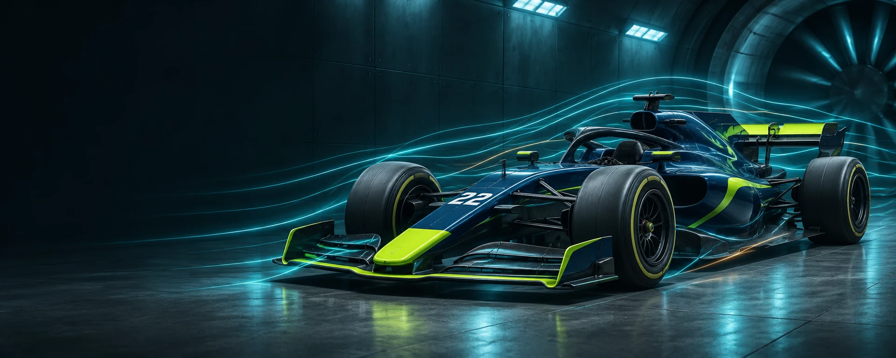

# Groundline Aerodynamics

Groundline is a browser-based racing simulator and aerodynamics lab. Race the open-wheel Formula 22, explore airflow around the same chassis in the wind tunnel, or test your own 3D mesh.

[Open the hosted Groundline site](https://groundline-circuit-lab.cdplayerx1.chatgpt.site). The hosted version requires access to the ChatGPT Site. You can also run the project locally.



## Run locally

Use a browser with WebGL enabled and a local HTTP server. Three.js and its loaders are included in the repository.

```sh
git clone https://github.com/CDplayerxOne/Aero-Simulation.git
cd Aero-Simulation
python3 -m http.server --bind 127.0.0.1 3000
```

Open [http://127.0.0.1:3000](http://127.0.0.1:3000). Serving over HTTP lets the browser load JavaScript modules, web workers, and the race car model.

## Drive

Open the [race garage](drive.html) and choose Sierra Vista, Copper Canyon, or Northwood Park. Each race runs for five laps against five computer-controlled opponents. The Formula 22 shifts automatically through eight gears. Turn on **Sound** to hear the 144 BPM garage track with live-kit drum sounds, electric bass, strings, and brass. The music fades as the garage door opens.

| Action | Keyboard |
| --- | --- |
| Throttle | `W` or `↑` |
| Brake | `S` or `↓` |
| Steer left or right | `A` / `D` or `←` / `→` |
| Drift handbrake | `Space` |
| Switch camera | `C` |
| Recover car | `R` |
| Pause or resume | `Esc` |

Touch devices get on-screen steering, throttle, brake, and drift controls. Open **Controls** in the garage or during a race to adjust steering sensitivity.

### Pair a phone
1. On the laptop, open the garage and choose **Pair phone**. A six-digit code appears for five minutes.
2. On the phone, open the Groundline home page and choose **Phone controller**. Enter the six digits and tap **Pair phone**. Scanning the laptop's QR with the phone also fills in the code.
3. When both screens say **Connected**, you can drive. Use the same Wi-Fi and the same signed-in ChatGPT account on both devices. Controls travel directly over WebRTC.

Hold the phone upright in portrait or landscape and allow motion access. Rotate it like a steering wheel and use **Recenter** for a comfortable neutral position. Touch steering is available alongside throttle, brake, drift, camera, recovery and race controls. Use HTTPS for motion access. Guest networks with client isolation can prevent a direct connection.

## Explore airflow

- **[Wind tunnel demo](wind-tunnel.html)** — Adjust air speed, yaw, and rear wing incidence. Inspect streamlines, estimated surface pressure, and undertray tracers. The telemetry panel shows Reynolds number, lift and drag coefficients, and estimates of drag and downforce. Turn on the **Aerodynamics guide** to explore parts of the car.
- **[Mesh playground](playground.html)** — Start with the reference airfoil or import an OBJ or STL file up to 20 MB and 350,000 triangles. Adjust air speed and angle of attack and inspect streamlines, the surface pressure heatmap, or the mesh wireframe. The browser reads and processes your file locally.

Both wind tunnels use simplified potential-flow models for qualitative comparisons. The demo's load estimates are illustrative, and the models do not resolve boundary layers or transient turbulence.

## Build and test

The build and tests were verified with Node.js 24. These commands require no package installation.

```sh
node build.mjs
node --test tests/*.mjs
```

The build embeds the site in a Cloudflare Worker at `dist/server/index.js`. The Worker serves the pages and exchanges WebRTC connection details using the site's R2 bucket. Codes are scoped to the signed-in account and consumed on pairing.

To test phone pairing locally, run `node build.mjs` and then `npx wrangler dev --config wrangler.dev.jsonc --local --ip 0.0.0.0` on a trusted LAN. Open the laptop's LAN address and the indicated port on both devices. This local configuration uses one shared test player. Use a trusted HTTPS endpoint for tilt on the phone. The Python static server above supports the game and wind tunnels without the pairing API.

## Project layout

| Path | Purpose |
| --- | --- |
| [`index.html`](index.html) | Home page and navigation |
| [`drive.html`](drive.html), [`js/race.js`](js/race.js), [`js/dynamics.js`](js/dynamics.js) | Race garage, race flow, and vehicle dynamics |
| [`js/circuits.js`](js/circuits.js), [`js/world.js`](js/world.js) | Circuit layouts and scenery |
| [`wind-tunnel.html`](wind-tunnel.html) | Original car demo, including chassis geometry and airflow calculations |
| [`playground.html`](playground.html), [`js/mesh-worker.js`](js/mesh-worker.js), [`js/flow-worker.js`](js/flow-worker.js) | Mesh playground, file parsing, and airflow solver |
| [`scripts/export-formula.mjs`](scripts/export-formula.mjs) | Generates the race car asset from the demo chassis |
